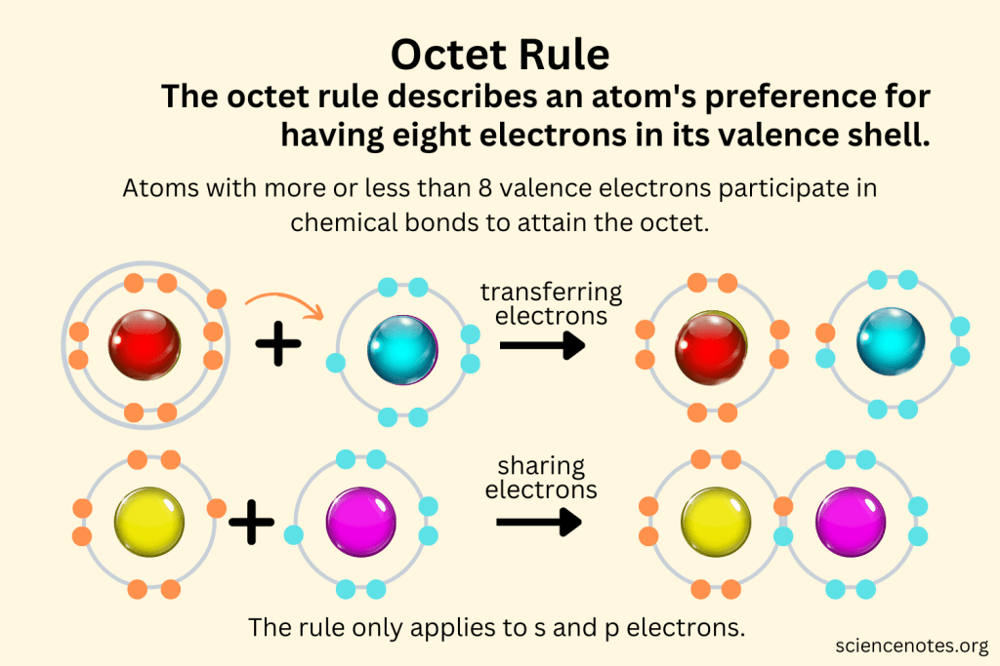

Balloon filled with helium will float because it's lighter than air. Oppositely, balloons pumped with regular air will not float.

Helium is an odorless, non-toxic, and colorless chemical with symbol He and atomic number 2.
Unlike hydrogen, it's non-flammable. That's why we avoid to fill balloons with hydrogen because it's flammable.

**Why hydrogen is flammable?**

Because it's a reactive element that readily combines with oxygen to form water in an energetic and heat-releasing chemical reaction.

**But why helium is not flammable while the difference only one proton?**

The reason why helium does not burn is because helium single electron shell can hold two electrons and helium has two electrons. That's why they're perfectly happily stable (duplet rule). Unlike hydrogen that has one electron while its shell wants 2, it aggressively unstable and violent with oxygen to get that second electron.

Also, oxygen actually has 8 electrons. Its inner shell holds 2 electrons and outer shell holds 6 electrons. Because oxygen follow octet rule---which the outer layer needs 8 electrons---oxygen desperately needs two more electrons to be happy. That's why oxygen is a perfect match with two hydrogen atoms which forms a water (H2O).

