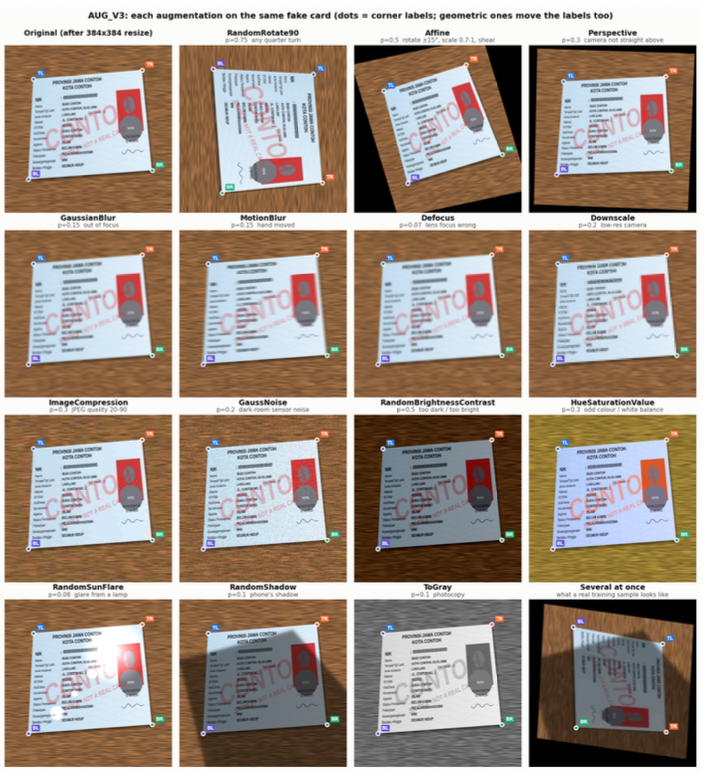

Image augmentation, or better addressed as data augmentation, is a method to make training samples have more variations to cover many possibilities of inputs that the client will send. In computer vision, it is advisable to create changes in the image we use for training. For example, add a little of rotation, blur, darken, or compress. Every time the model sees the image during training, it sees a slightly different version.

 

 Take an example of a KTP image. It was labeled by hand to get the corner of the card. Real users will probably  give us a blurry, darken, or skewed card position. We can't collect every cases.  To anticipate that, we can simulate many of them. 

 

On top of that, we must keep the label true in any kind of augmentation applied. If the image is rotated, the label should also be rotated. If the image is skewed, the corners must follow. 
